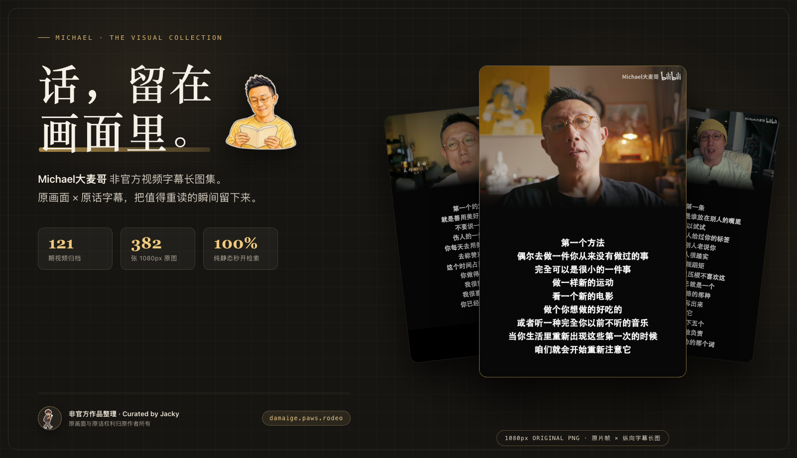
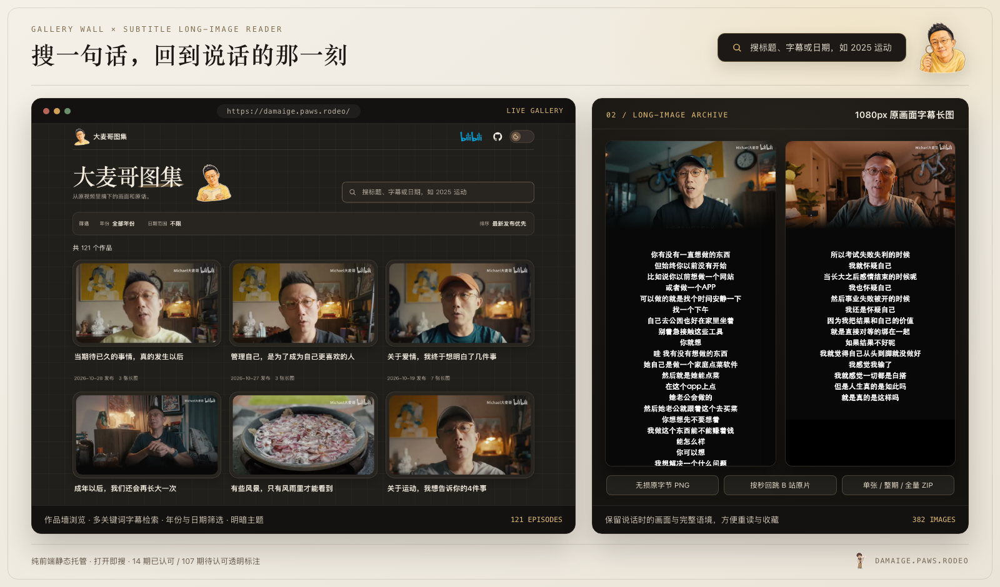

<p align="center">
  
</p>

# Michael大麦哥 · 影像摘录

**话，留在画面里。**

一个为重读与收藏而做的非官方视频字幕长图集——收录 **121 期视频、382 张 1080px 原画面长图**，把值得反复翻看的一段话连同说话时的神情与语境一起留下来。支持按标题或一句字幕即时搜索、纵向沉浸阅读、精确秒数回跳 B 站原片，以及无损原图下载。

[在线浏览图集 ↗](https://damaige.paws.rodeo/) · [下载全部原图 ZIP（391 MB）](https://jacky-bucket-hk.oss-cn-hongkong.aliyuncs.com/michael-damaige-gallery/2026-11-03/michael-damaige-121-videos-382-images.zip) · [去 B 站关注原作者 ↗](https://space.bilibili.com/324213598) · [公开作品索引](public/catalog.json)

## 浏览与阅读体验

<p align="center">
  
</p>

| 能力 | 说明 |
|---|---|
| **一句话搜全库** | 支持按视频标题、已选字幕关键词实时检索，快速定位到具体那一期 |
| **原画面纵向长图** | 每张图保留 `1080px` 宽原字节 PNG，不二次压缩，读文字也看得到原片氛围 |
| **精确回看原片** | 每张长图附带原片时间戳，点击直接从对应秒数跳转 B 站核对完整语境 |
| **灵活原图下载** | 支持单张保存、单期 ZIP 或全量 382 张原图打包下载（Store 无损打包） |
| **纯静态零后端** | 页面打开时读取一次 [`public/catalog.json`](public/catalog.json)，交互全部在本机完成，无轮询、无数据库 |

## 本地预览

图片体积较大，独立托管且不进入 Git 历史。本地完整预览前先恢复公开原图并逐张校验 SHA-256（需要 Node.js 22+ 与 `curl`）：

```bash
npm ci
npm run restore-images
npm run check
node scripts/serve.mjs
```

打开 `http://127.0.0.1:8798` 即可浏览。仅预览目录时可跳过 `restore-images`；如网络需代理，在当前命令环境设置 `HTTPS_PROXY` 即可。

<details>
<summary>项目结构、维护与部署说明</summary>

- `public/` 是唯一部署目录，包含静态页面与 [`public/catalog.json`](public/catalog.json)（记录每期 BVID、图片尺寸、字节数、SHA-256、字幕与原图包地址）。
- [`scripts/restore-images.mjs`](scripts/restore-images.mjs) 下载并核验原图；[`scripts/check.mjs`](scripts/check.mjs) 校验目录完整性；[`scripts/zip.mjs`](scripts/zip.mjs) 提供确定性无损 Store 打包。
- 仓库不包含原始视频、音频、全量转写、凭据或私有处理日志。

```bash
npm run check
npx wrangler deploy --dry-run
npm run deploy
```

图片由 Cloudflare Workers Static Assets 分发，原图包存放于 OSS 独立前缀（仅对公开包对象开放只读，不修改 Bucket 全局 ACL）。全量 ZIP 大小 `410564239` 字节，SHA-256：`9db59d384e6289975d8c82d281a18ce04b13ee5b8b939d24e748585c497a07a9`。

</details>

## 内容边界与版权说明

- **收录与认可状态**：历史 20 期（116 张）与新增 101 期（266 张）合并，每个 BVID 仅收录一个允许版本。其中 **14 期（90 张）** 已获整理委托者内容认可；**107 期（292 张）** 待认可（含 2 期 6 张早期样例）。认可仅表示整理质量记录，不代表原作者授权或事实认证。
- **语境与权利归属**：未完成全片逐字音频听校，也未独立核实全部科学、健康与心理学论断，请结合 B 站原片语境阅读。**所有视频画面与原话权利均归原作者 [Michael大麦哥](https://space.bilibili.com/324213598) 所有**，本仓库不对第三方内容授予再许可。

> 本页视觉素材来源与核验记录见 [docs/readme/SOURCES.md](docs/readme/SOURCES.md)。
