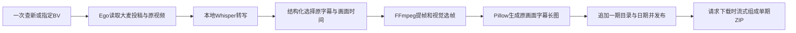

# 逐期同步与按需下载

新一期依次经过作者身份核对、实际音视频采集、本地转写、原话选段、候选帧检查、长图渲染和增量发布。每期以 BV 号去重，保留原始素材和阶段摘要；新内容标为 `review`，不会自动变成用户已认可的内容。



查新只读取当前最新投稿页，用已收录视频的最新发布日期作为边界，按期串行处理新视频；已知置顶视频不会提前截断列表。找不到边界时停止并报告范围，避免把有限列表误当完整历史。只接受 UID `324213598` 的单 P 视频；多 P 或身份不符会停止处理。

自动选段只能引用字幕 ID，摘选也必须是原文连续子串。卡片不添加模型摘要或新标题。自动转写可能误识别人名、书名和细微语气，因此保留原片、原始转写、引用证据和待核对状态。程序校验不能代替逐字听校。

## 执行环境

在处理机器安装 Node.js 24、FFmpeg/ffprobe、Ego Lite 和已登录的原生 Codex CLI。复用 `video-to-cards` Skill 与已有 MLX Whisper 环境，另外创建 Pillow 环境，避免修改共享语音模型环境。代码不读取平台 API Key，也不保存 Cookie、签名媒体地址或原始模型进程日志。

在公开目录之外保存私有配置，例如：

```json
{
  "dataRoot": "/private/gallery-pipeline",
  "deploymentRoot": "/private/gallery-deployment",
  "baselineRelease": "/private/gallery-deployment/releases/CURRENT_RELEASE",
  "videoCardsSkill": "/installed/video-to-cards",
  "whisperPython": "/installed/whisper/bin/python",
  "renderPython": "/installed/gallery-render/bin/python",
  "font": "/installed/chinese-font.ttc",
  "codexBin": "/installed/bin/codex"
}
```

```sh
npm run pipeline -- discover --config /private/gallery-config.json
npm run sync -- --config /private/gallery-config.json
npm run sync -- --config /private/gallery-config.json --apply
npm run pipeline -- process --config /private/gallery-config.json --bvid BV1ttykzFERD --apply
npm run pipeline -- status --config /private/gallery-config.json
# 只读核对上次结果不明的发布，不重发：
npm run pipeline -- reconcile --config /private/gallery-config.json --bvid BV1ttykzFERD
```

默认只生成独立冻结快照。`--apply` 才逐期部署。一次运行只有一个处理锁，没有周期查新、任务状态轮询、Cron 或 Alarm。后台触发方式仍需遵循当前用户约定；本实现不等于已经安装无人值守的定时服务，网页也尚未接入生成任务后端。

## 恢复与发布保护

阶段完成会保存输入/输出摘要；恢复时先核对原文件，再跳过已完成工作。失败保留素材和错误类别，不自动切换模型，也不自动重发结果不明的部署。进程取消会终止本次进程组，避免 Whisper 在后台继续写入。进程异常退出遗留锁时，先核实旧进程已结束，再用 `unlock` 命令恢复。

发布从当前生产快照追加一期。旧图、旧内容认可状态、样式、响应头与部署配置保持；仅目录、日期、主页两个内联数据块、下载页和新一期图片可变化。所有图核对 SHA、CRC、大小、尺寸及本期路径，生成独立 `change-proof.json`。Worker 打成独立单文件，私有素材和证据不进入公开资源。

每张图片生成/导入时计算 CRC 和 SHA，下载请求直接读取本期原图组成 Store ZIP，使用背压、取消传递和精确长度；没有新预制 ZIP。旧 ZIP 只留作历史回退。下载页校验 ZIP 成员原图后保存；超出浏览器内存保护阈值的大包交由浏览器直接下载。

配置 `imageOpsScript` 时，卡片完成后会归档到已有私有 Image OPS 素材库，并读回核对 SHA。素材索引和完整记录不进入公开快照。查新结果保存在私有待处理列表；先处理较新单期也不会丢失已经发现的较早缺期。

2026-11-26 实测：补齐 6 期、78 张新卡片，正式目录达到 127 期、460 张；85 项回归与全库原图校验通过。82 个新增或变更的公开文件完整 HTTP/SHA 一致。改域名自动下载 17 张、粘贴下载 15 张，均真实落盘并通过独立 CRC 和成员 SHA 核对。新内容保持 review，实体手机与持续后台触发尚未验收。

冻结发布支持精确直接父快照的反向证明校验，默认仍只检查；只有操作者明确提供旧目标、当前基线和 `--apply` 才执行回退。代码变化或首页不变的候选不能仅凭首页完成 `--verify` 对账。不要在激活结果不明时重复上传。
